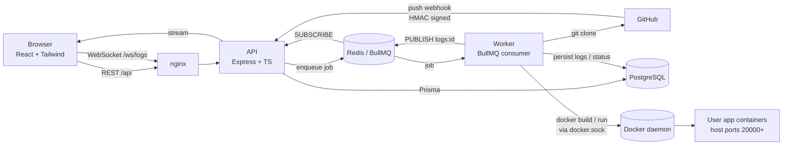

# Architecture

## System diagram



## Deployment flow

```mermaid
sequenceDiagram
  participant UI
  participant API
  participant Q as Redis/BullMQ
  participant W as Worker
  participant D as Docker
  UI->>API: POST /projects/:id/deploy
  API->>API: create Deployment(QUEUED)
  API->>Q: add job (jobId = deploymentId)
  API-->>UI: 202 {id}
  UI->>API: WS /ws/logs?deploymentId=…
  Q->>W: job
  W->>W: acquire per-project lock
  W->>W: git clone --depth 1
  W->>D: docker build
  W->>D: docker rm -f old; docker run new (env-file)
  W->>W: verify container is running
  W->>API: (via Redis pub/sub) log lines + status
  API-->>UI: live stream
```

## Key design decisions

| Decision | Why |
|---|---|
| API and worker are separate processes | Builds are CPU/IO heavy and long-running; API stays responsive, worker scales independently. |
| Logs are persisted **and** published | DB gives history for late joiners / refresh; Redis pub/sub gives low-latency live streaming across processes. |
| Rollback re-runs the stored image | Instant (no rebuild) and byte-identical to what was running before. Creates a new Deployment row linked via `rollbackOfId`, so history stays append-only. |
| Per-project Redis lock | Container name and host port are per-project; prevents two deploys racing. |
| Cancellation via Redis flag | Works across processes; the worker polls the key and `SIGKILL`s the active child process. Queued jobs are removed directly. |
| Env vars: AES-256-GCM, write-only API | Authenticated encryption; values are only decrypted in the worker and passed via a 0600 env-file deleted after start (never in `ps`/logs). |
| `authenticate` re-loads the user | Deleted users and role changes take effect immediately instead of when the JWT expires. |
| Strict input allow-lists for repo URL/branch | Values reach `git clone`; only `https://github.com/<owner>/<repo>` and safe branch names are accepted, and processes are spawned with arg arrays (no shell). |

## Database schema

```mermaid
erDiagram
  User ||--o{ Project : owns
  User ||--o{ Deployment : triggers
  Project ||--o{ EnvVar : has
  Project ||--o{ Deployment : has
  Deployment ||--o{ DeploymentLog : emits
  Deployment |o--o{ Deployment : "rollbackOf"

  User { uuid id PK; string email UK; string passwordHash; enum role }
  Project { uuid id PK; string name; string repoUrl; string branch; enum environment; int containerPort; int hostPort UK; string webhookSecret; uuid ownerId FK; uuid currentDeploymentId }
  EnvVar { uuid id PK; uuid projectId FK; string key; string valueEnc }
  Deployment { uuid id PK; uuid projectId FK; enum status; string commitHash; string imageTag; string url; int durationMs; uuid rollbackOfId FK; datetime startedAt; datetime finishedAt }
  DeploymentLog { int id PK; uuid deploymentId FK; string line; datetime createdAt }
```

Full definition: [`backend/prisma/schema.prisma`](../backend/prisma/schema.prisma).
